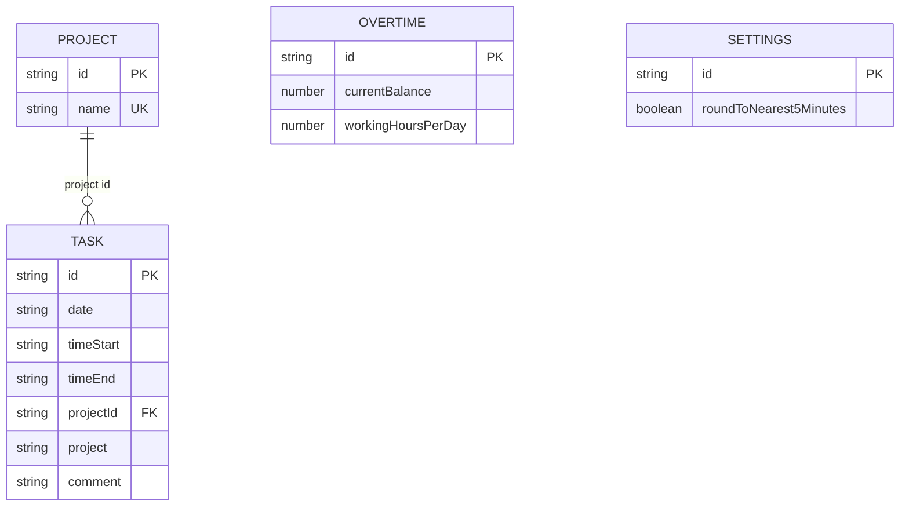

# Effortum Architecture

## Purpose

Effortum is a local-first time tracker. User data is persisted in IndexedDB via Dexie and mirrored in app state via Zustand.

## Main Architecture Pillars

1. Local-first persistence: all core data is stored in IndexedDB (Dexie), no backend required.
2. Single state layer: UI reads and writes through a centralized Zustand store.
3. Typed domain model: entities are defined as TypeScript model types in `src/models`.
4. Route-driven UI: TanStack Start + React pages and components organize interaction flows.
5. Validation and utility boundaries: input validation and date/time logic live in dedicated modules.
6. Test coverage by layer: Vitest for utilities/components, Playwright for end-to-end user flows.

## Entity Relationship Diagram

## Runtime Structure

- UI layer: routes (`src/routes`) render pages (`src/pages`) composed from reusable components (`src/components`), including the Projects page for
  alphabetically ordered project renaming with per-row save controls and project deletion (supporting zero-task deletion or modal-based task deletion/migration
  with comment conflict checks), and the Tasks page for per-project task-comment management.
- State layer: `src/store.ts` is a thin facade that re-exports the composed store from `src/store/index.ts`. The composed store is organized into focused slices
  under `src/store/slices`: `taskSlice`, `projectSlice`, `commentSlice`, `settingsOvertimeSlice`, `uiSlice`, and `loadingMigrationSlice`. This keeps domain
  logic isolated while preserving a single Zustand store for consumers.
- Persistence layer: `src/db.ts` defines Dexie schema versions and object stores.
- Domain layer: `src/models` contains strongly typed entities used across store and UI.
- Logic layer: `src/utils` contains date, time, and filtering behavior.

## Data Flow

1. UI events trigger store actions.
2. Store actions write/read Dexie tables.
3. Store refreshes in-memory state from persisted records.
4. React components re-render from Zustand state.

## Key Constraints

- Task-to-project relations are canonical by project ID.
- Comment suggestions are derived from persisted `task.comment` values; no dedicated comment entity is used.
- Project deletion requires handling associated tasks: zero-task projects can be deleted directly with confirmation; task-bearing projects require choosing
  between permanently deleting associated tasks or reassigning them to a destination project.
- Moving tasks checks for conflicting task comments between projects, warning the user and guiding them to the Task Management page if needed.
- Legacy project-name fields are kept during rollout for import/export compatibility and recovery.
- Overtime and settings are single-record entities identified by fixed IDs.
- Date filtering must normalize date-only and ISO datetime values for day-level comparisons.
- Only one active (running) task without an end time is permitted across the application at any time. When an active task is running outside the current date
  range, it is surfaced to the user with an alert and guidance to stop it before a new active task can be started.
- Tasks can be restarted from the task list actions column via a quick start button that launches a new running task for the current date with matching project
  and comment, applying 5-minute rounding if enabled, and hidden whenever any task is actively running.

## Architectural Invariant Enforcement

The repository enforces four non-negotiable architectural invariants via `pnpm check:invariants` (`scripts/check-invariants.ts`):

1. `no-direct-dexie-in-ui`: UI components and pages must query state exclusively via Zustand store slices, never importing `dexie` or `src/db` directly
   (whitelisted: `ExportData.tsx` and `ImportData.tsx`).
2. `enforce-dayjs`: All date and time operations across application code in `src/` must use `dayjs` rather than raw `new Date()`.
3. `dexie-migration-immutability`: Historical database schema versions in `src/db.ts` must never be modified in-place; schema changes must append a new
   `version(N + 1)` block.
4. `no-suppressed-tests-or-types`: Prohibits introducing `@ts-ignore`, `@ts-nocheck`, `it.skip`, `test.skip`, `describe.skip`, and test isolation (`.only`).

## Autonomous Development Pipeline & Spec Archiving

Autonomous issue implementation is driven through Antigravity CLI via `/implement-issue` (`skills/implement-issue/SKILL.md`) using a Separation-of-Powers model:

- **Lead Architect (Orchestrator)**: Triages GitHub issues labeled `ready-for-implementation`, evaluates sizing heuristics, drafts the contract, and pauses for
  Human Gate 1.
- **Builder Subagent (`feature-implementer`)**: Defined in `agents/feature-implementer.md`. Executes vertical slices task-by-task using
  `incremental-implementation` with up to 3 self-healing cycles.
- **Independent Auditor Subagent (`architectural-auditor`)**: Defined in `agents/architectural-auditor.md`. Runs in a clean context to verify invariants
  (`pnpm check:invariants`), execute test suites, update documentation, and stage the PR for Human Gate 2.

All feature and bug specifications are stored immutably in issue-scoped directories under `docs/specs/issue-<id>-<slug>/` containing `spec.md`, `plan.md`,
`tasks.md`, and `audit-report.md`. This ensures specs never overwrite each other, while `docs/architecture.md` remains the unified living source of truth.

## Documentation and Formatting

- Update files in `docs` whenever architecture or entity behavior changes.
- Markdown is formatted with Prettier using max line length 160 for prose; tables and diagrams are left structurally intact.
