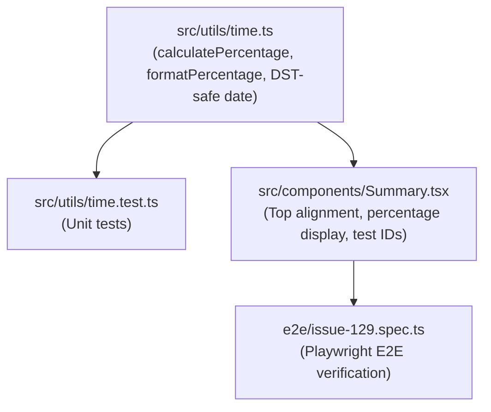

# Plan: feat: show spent time per project in percent (#129)

## Component Dependency Graph

## Implementation Order

1. **Foundations (Utility Layer):**
   - Add `calculatePercentage(part: number, total: number): number` and `formatPercentage(part: number, total: number): string` to `src/utils/time.ts`.
   - Update `getDurationAsTime` and `getDuration` in `src/utils/time.ts` to use a neutral date reference string (e.g. `2000-01-01`) instead of
     `dayjs().format("YYYY-MM-DD")`, ensuring time-of-day calculations are immune to Daylight Saving Time (DST) transitions.
   - Author comprehensive unit tests in `src/utils/time.test.ts` covering:
     - Zero total (`formatPercentage(0, 0)` -> `"0 %"`).
     - Standard single item (`formatPercentage(60, 60)` -> `"100 %"`).
     - Example 1 from issue: 240 / 360 -> `"67 %"` and 120 / 360 -> `"33 %"`.
     - Example 2 from issue: 90 / 510 -> `"18 %"`, 45 / 510 -> `"9 %"`, 375 / 510 -> `"74 %"` (sum = 101 %).
     - Verify all Vitest tests pass cleanly.

2. **UI Implementation (`Summary.tsx`):**
   - Import `formatPercentage` from `../utils/time`.
   - In the Summary table body rows:
     - Set vertical alignment to top on all `<Table.Td>` elements (`style={{ verticalAlign: "top" }}`).
     - In column 2 (duration column), render the hours value (`formatDuration(item.time)`) on the first line and the percentage value
       (`formatPercentage(item.time, timeSum)`) on the second line with `data-testid={`summary-percentage-${item.label}`}`.
     - Ensure the percentage uses the same font styling as the hours value.
     - Verify the clipboard icon in column 1 and the label in column 3 also align to the top.
     - Ensure the footer table rows (`Table.Tfoot`) do NOT show any percentage values.

3. **E2E Verification (`e2e/issue-129.spec.ts`):**
   - Add dedicated Playwright test suite in `e2e/issue-129.spec.ts`:
     - Test display of project percentage for multiple projects matching the issue's Example 2 (01:30, 00:45, 06:15 -> 18 %, 9 %, 74 %).
     - Test display in "List by task" mode.
     - Test that the footer sum row displays only the hours sum and no percentage sum.
     - Test layout / vertical alignment attributes.

4. **Invariant and Quality Auditing:**
   - Execute `pnpm check:invariants`
   - Execute `pnpm test`
   - Execute `pnpm test:e2e`
   - Execute `pnpm tsc --noEmit`
   - Execute `pnpm prettier --write .`

## Risks and Mitigations

| Risk                                                              | Mitigation                                                                                                                                 |
| ----------------------------------------------------------------- | ------------------------------------------------------------------------------------------------------------------------------------------ |
| Division by zero when total time is 0                             | `calculatePercentage` returns `0` if `total <= 0` or invalid, rendering `"0 %"`.                                                           |
| DST transition causes 23 or 25-hour day diffs in time calculation | Use fixed reference date `2000-01-01` for day-agnostic time difference calculations in `time.ts`.                                          |
| Mantine table layout breaking with top vertical alignment         | Apply `verticalAlign: "top"` directly to `Table.Td` elements or via Mantine styles, ensuring clean top alignment across all three columns. |
| Negative durations                                                | Guard with `Math.max(0, ...)` if ever encountered.                                                                                         |

## Verification Checkpoints

- Checkpoint 1: `pnpm test src/utils/time.test.ts` passes with 100% green tests.
- Checkpoint 2: `pnpm check:invariants && pnpm tsc --noEmit` passes with 0 errors.
- Checkpoint 3: `pnpm test:e2e e2e/issue-129.spec.ts` passes cleanly in headless mode.
- Checkpoint 4: Full suite: `pnpm check:invariants && pnpm test && pnpm test:e2e` passes.
