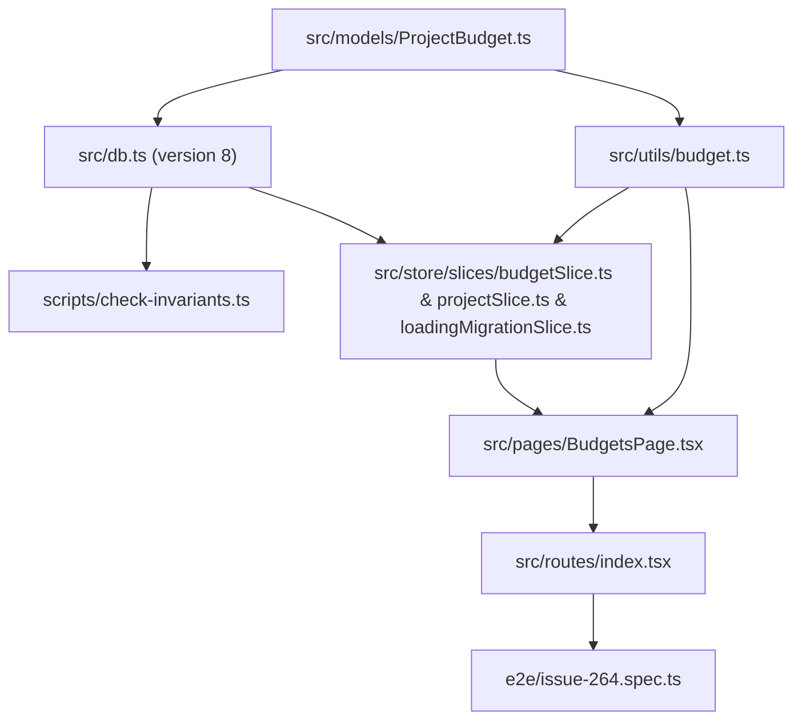

# Plan: Add Project Budget Persistence and Dedicated Budget Management Page (#264)

## 1. Component Dependency Graph

## 2. Implementation Order

1. **Domain Model, Dexie Migration & Invariant Guard:**
   - Create `src/models/ProjectBudget.ts`.
   - Append `this.version(8)` in `src/db.ts` with `budgets: "&id, projectId, startDate, endDate, purpose, hours"`.
   - Update `FROZEN_DEXIE_VERSIONS` in `scripts/check-invariants.ts` and `scripts/check-invariants.test.ts`.
   - Update `src/components/ImportData.tsx` so database clear and fallback import also handle `budgets`.
2. **Budget Utility Functions & Constants:**
   - Create `src/utils/budget.ts` and `src/utils/budget.test.ts` with `MAX_BUDGET_PURPOSE_LENGTH = 50`, `MAX_BUDGET_HOURS = 17520`,
     `sortProjectBudgetsNewestFirst`, `formatBudgetMetricNumber`, and `formatBudgetMetrics`.
3. **Zustand Store Slice & Project Deletion Integration:**
   - Extend `EffortumStore` in `src/store/types.ts` with `budgets`, `addProjectBudget`, `updateProjectBudget`, `deleteProjectBudget`, and
     `getProjectBookedTimeHoursInRange`.
   - Implement `src/store/slices/budgetSlice.ts` and unit tests in `src/store/slices/budgetSlice.test.ts` (enforcing `0 < hours <= MAX_BUDGET_HOURS` with
     `"BUDGET_HOURS_TOO_HIGH"`).
   - Update `src/store/slices/loadingMigrationSlice.ts` and `src/store/slices/projectSlice.ts`.
4. **Dedicated Budget Management Page & Navigation:**
   - Implement `src/pages/BudgetsPage.tsx` with:
     - Project selector (`data-testid="budget-project-select"`).
     - Add budget form (`startDate`, `endDate`, `purpose` with `maxLength={50}`, `hours` with `max={17520}`, and `Add Budget` button).
     - Newest-first sorted list of budget rows where every column (`startDate`, `endDate`, `purpose`, `hours`, `budget-metrics-<id>`, `Save`, `Delete`) uses
       fixed flex basis/width (`flex: "0 0 <width>px"` for fixed columns and `flex: "1 1 0", minWidth: 0` for `purpose`) so all columns have identical widths
       across rows regardless of budget size.
     - Delete Budget Confirmation `<Modal>` (`data-testid="modal-delete-budget"`).
   - Add `Budgets` (`data-testid="nav-budgets"`) to `NAV_ITEMS` in `src/routes/index.tsx`.
5. **End-to-End Verification & Architecture Docs:**
   - Update `e2e/issue-264.spec.ts` to verify `MAX_BUDGET_HOURS` (`17520`) validation, uniform column widths across rows with small vs. large budgets,
     per-budget metrics, editing, and delete confirmation modal.
   - Update `docs/architecture.md` to document the `17520` hours maximum and fixed-width row columns.

## 3. Risks and Mitigations

- **Risk:** Variable-length state text (e.g. `0/17520 h (0/2190 days) · 0%` vs `4/8 h (0.5/1 days) · 50%`) causing the metrics column to expand and shrink the
  `purpose` input column on that row.
  - **Mitigation:** Give the metrics `<Text>` element a fixed width (`w={260}` and
    `style={{ flex: "0 0 260px", whiteSpace: "nowrap", fontVariantNumeric: "tabular-nums" }}`) and give `startDate`, `endDate`, `hours`, `Save`, and `Delete`
    explicit `flex: "0 0 ..."` widths while `purpose` uses `style={{ flex: "1 1 0", minWidth: 0 }}`.

## 4. Verification Checkpoints

- After Task 8: `pnpm test src/store/slices/budgetSlice.test.ts` and `pnpm tsc --noEmit` pass.
- After Task 9: `pnpm test:e2e e2e/issue-264.spec.ts` passes headless.
