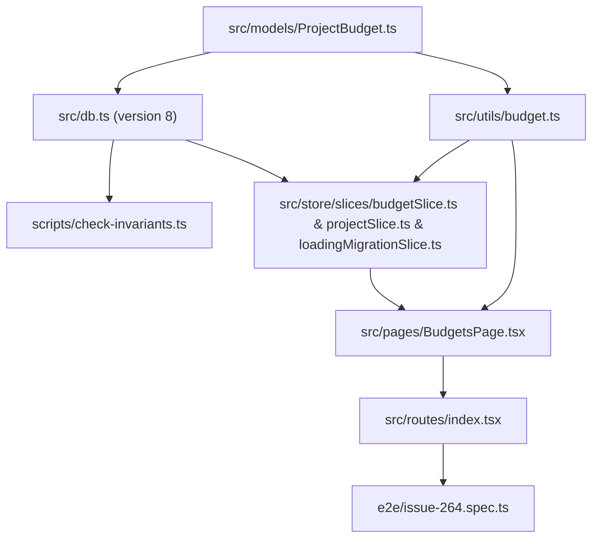

# Plan: Add Project Budget Persistence and Dedicated Budget Management Page (#264)

## 1. Component Dependency Graph

## 2. Implementation Order

1. **Domain Model, Dexie Migration & Invariant Guard:**
   - Create `src/models/ProjectBudget.ts`.
   - Append `this.version(8)` in `src/db.ts` with `budgets: "&id, projectId, startDate, endDate, purpose, hours"`.
   - Update `FROZEN_DEXIE_VERSIONS` in `scripts/check-invariants.ts` and `scripts/check-invariants.test.ts`.
   - Update `src/components/ImportData.tsx` so database clear and fallback import also handle `budgets`.
2. **Budget Utility Functions:**
   - Create `src/utils/budget.ts` and `src/utils/budget.test.ts` for:
     - `sortProjectBudgetsNewestFirst(budgets)`: sorts by `startDate` descending (newest first), then `endDate` descending, then `purpose`.
     - `formatBudgetMetricNumber(value)`: formats numbers up to 2 decimal places without trailing zeroes (e.g. `4.5`, `11`, `100`).
     - `formatBudgetMetrics(spentHours, budgetedHours, workingHoursPerDay)`: formats `<spent>/<budgeted> h (<spentDays>/<budgetedDays> days) · <percent>%` (e.g.
       `36/88 h (4.5/11 days) · 41%`).
3. **Zustand Store Slice & Project Deletion Integration:**
   - Extend `EffortumStore` in `src/store/types.ts` with `budgets`, `addProjectBudget`, `updateProjectBudget`, `deleteProjectBudget`, and
     `getProjectBookedTimeHoursInRange`.
   - Implement `src/store/slices/budgetSlice.ts` and unit tests in `src/store/slices/budgetSlice.test.ts`.
   - Update `src/store/slices/loadingMigrationSlice.ts` to load `budgets` in `loadFromIndexedDb`.
   - Update `src/store/slices/projectSlice.ts` and `src/store/slices/projectSlice.test.ts` so `deleteProject` deletes budgets when tasks are deleted (or project
     has 0 tasks) and moves budgets to `destinationProjectId` when tasks are moved.
   - Register `createBudgetSlice` in `src/store/index.ts`.
4. **Dedicated Budget Management Page & Navigation:**
   - Implement `src/pages/BudgetsPage.tsx` with:
     - Project selector (`data-testid="budget-project-select"`).
     - Add budget form (`startDate`, `endDate`, `purpose` with `maxLength={50}`, `hours`, and `Add Budget` button).
     - Newest-first sorted list of budget rows with editable `startDate`, `endDate`, `purpose` (`maxLength={50}`), `hours`, per-row spent/budgeted metrics
       (`data-testid="budget-metrics-<id>"`), `Save` button (`data-testid="button-save-budget-<id>"`), and `Delete` button
       (`data-testid="button-delete-budget-<id>"`).
     - Delete Budget Confirmation `<Modal>` (`data-testid="modal-delete-budget"`) with `Cancel` (`data-testid="button-cancel-delete-budget"`) and
       `Delete Budget` (`data-testid="button-confirm-delete-budget"`) buttons.
     - No overall project budget summary box.
   - Add `Budgets` (`data-testid="nav-budgets"`) to `NAV_ITEMS` in `src/routes/index.tsx`.
5. **End-to-End Verification & Architecture Docs:**
   - Update `e2e/issue-264.spec.ts` covering adding multiple budgets, newest-first sorting, per-budget spent/budgeted hours/days/percent metrics, editing
     budgets, and deleting a budget via the confirmation modal (testing both cancel and confirm).
   - Update `docs/architecture.md` to document the `PROJECT_BUDGET` table, `budgetSlice`, and `BudgetsPage` (with delete confirmation and per-budget metrics).

## 3. Risks and Mitigations

- **Risk:** Accidental deletion of a budget when clicking `Delete`.
  - **Mitigation:** Require explicit confirmation in a Mantine `<Modal>` (`modal-delete-budget`) before invoking `deleteProjectBudget`.
- **Risk:** Division by zero when `workingHoursPerDay` is not yet configured or `budgetedHours` is `0`.
  - **Mitigation:** Default `workingHoursPerDay` to `8` when missing or `<= 0`, and use `calculatePercentage` which safely returns `0` when total `<= 0`.
- **Risk:** Tasks booked outside the currently loaded calendar date range might not be in `state.tasks` in memory.
  - **Mitigation:** Query IndexedDB via `getProjectBookedTimeHoursInRange` in the store slice.

## 4. Verification Checkpoints

- After Task 6: `pnpm tsc --noEmit` and `pnpm check:invariants` pass.
- After Task 7: `pnpm test:e2e e2e/issue-264.spec.ts` passes headless.
