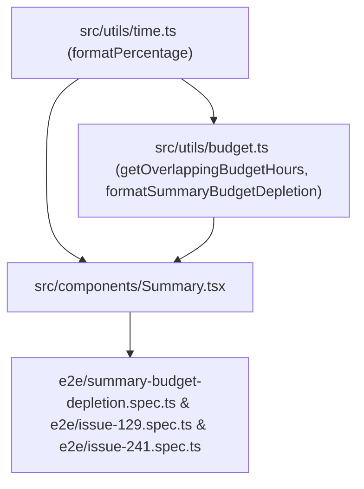

# Plan: Display Project Budget Depletion in Summary Panel and Format Percentages Without Space (#265)

## 1. Component Dependency Graph

## 2. Implementation Order

1. **Standardize Percentage Formatting (`src/utils/time.ts`):**
   - Update `formatPercentage` in `src/utils/time.ts` from `` `${calculatePercentage(part, total)} %` `` to `` `${calculatePercentage(part, total)}%` ``.
   - Update unit tests in `src/utils/time.test.ts` and E2E expectations in `e2e/issue-129.spec.ts` and `e2e/issue-241.spec.ts`.
2. **Date-Range Overlapping Budget Calculation & Formatting (`src/utils/budget.ts`):**
   - Implement `getOverlappingBudgetHours(budgets, projectId, selectedDateRange)` using `normalizeDate` (`dayjs`) to sum `budget.hours` for all budgets of
     `projectId` where `budgetStart <= rangeEnd` and `budgetEnd >= rangeStart` (at day granularity).
   - Implement `formatSummaryBudgetDepletion(spentHours, budgetHours)` returning `{ label: "Budget: X%", tooltip: "X/Y hours" }` using
     `formatDepletionPercentage` (at most 1 decimal place, e.g. `1.5%` or `17%`).
   - Add unit tests in `src/utils/budget.test.ts` covering all 4 date-range examples from #258/#265 and decimal rounding.
3. **Summary Panel Depletion Display & Tooltip (`src/components/Summary.tsx`):**
   - Subscribe to `budgets` from `useEffortumStore`.
   - Rename checkbox label "Show percentages" to "Project allocation (%)".
   - For each summary item when `!listByTasks && item.projectId`:
     - Compute `budgetHours = getOverlappingBudgetHours(budgets, item.projectId, selectedDateRange)`.
     - When `budgetHours > 0`, render
       `<Tooltip label={tooltip}><Box data-testid={`summary-budget-depletion-${item.label}`} style={{ width: "fit-content" }}>{label}</Box></Tooltip>` below
       `<Box>{item.label}</Box>`.
4. **End-to-End Verification & Architecture Documentation:**
   - Add `e2e/summary-budget-depletion.spec.ts` verifying:
     - Overlapping budget summation across different date ranges (`Sum = 0`, single budget, overlapping budgets).
     - `Budget: X%` layout with and without `Project allocation (%)` checked.
     - `X/Y hours` tooltip on hover.
     - Hiding `Budget: X%` when `List by task` is checked.
     - Decimal depletion percentage formatting (e.g. `Budget: 1.5%`).
   - Update `docs/architecture.md` to document summary panel budget depletion.

## 3. Risks and Mitigations

- **Risk:** Existing E2E tests (`e2e/issue-129.spec.ts` and `e2e/issue-241.spec.ts`) assert the old `"X %"` format with a space.
  - **Mitigation:** Update `e2e/issue-129.spec.ts` and `e2e/issue-241.spec.ts` in Task 1 and verify them with Playwright.
- **Risk:** Single-day selection in `selectedDateRange` may have `[date, date]` or `[date, null]` while user is picking a range.
  - **Mitigation:** Normalize `rangeEnd = normalizeDate(rawEnd ?? rawStart)` so single-day ranges work identically in both `[date, date]` and `[date, null]`
    states.

## 4. Verification Checkpoints

- After Task 1: `pnpm test src/utils/time.test.ts` and `pnpm test:e2e e2e/issue-129.spec.ts e2e/issue-241.spec.ts` pass.
- After Task 2: `pnpm test src/utils/budget.test.ts` passes.
- After Task 3: `pnpm tsc --noEmit` and `pnpm check:invariants` pass.
- After Task 4: `pnpm test:e2e e2e/summary-budget-depletion.spec.ts` passes headless.
