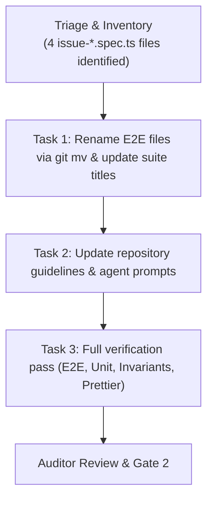

# Plan: tests: rename e2e files (#277)

## Technical Approach

The goal is to cleanly rename all issue-named Playwright E2E test files (`issue-*.spec.ts`) to descriptive, capability-based functional names, refine their
internal `test.describe` headings to reflect functionality rather than issue IDs, verify all tests pass without regressions, and align workflow guidance in
`AGENTS.md` and `.agents/`.

## Implementation Order

1. **Phase 1: File Renames & Suite Title Cleanup (`e2e/`)**
   - Execute atomic `git mv` for each of the 4 files:
     - `e2e/issue-51.spec.ts` ➔ `e2e/task-manual-add-prefill.spec.ts`
     - `e2e/issue-128.spec.ts` ➔ `e2e/task-autocomplete-sorting.spec.ts`
     - `e2e/issue-129.spec.ts` ➔ `e2e/summary-project-allocation.spec.ts`
     - `e2e/issue-241.spec.ts` ➔ `e2e/summary-project-allocation-toggle.spec.ts`
   - Update `test.describe(...)` title inside each renamed file to remove issue numbers and clarify the tested capability.
   - Run Playwright E2E execution on all 4 renamed files to ensure discovery and execution pass cleanly.

2. **Phase 2: Repository Guidance & Agent Workflow Sync (`AGENTS.md`, `.agents/`)**
   - Update `AGENTS.md` under Autonomous Feature & Bug Implementation Workflow to specify functional E2E test file naming (`e2e/<functional-name>.spec.ts`).
   - Update `.agents/skills/implement-issue/SKILL.md` to instruct architects and subagents to define functional names based on the capability.
   - Update `.agents/agents/feature-implementer.md`, `.agents/agents/code-simplifier.md`, and `.agents/agents/architectural-auditor.md`.

3. **Phase 3: Verification & Invariant Checks**
   - Run `pnpm check:invariants` (enforce no suppressed tests or types, no direct dexie in UI).
   - Run `pnpm test` (verify all 150 unit tests pass).
   - Run `pnpm test:e2e` (verify all Playwright E2E tests pass across the entire suite).
   - Run `pnpm tsc --noEmit`.
   - Run `pnpm prettier --check .` (and format if necessary).

## Risks & Mitigations

- **Risk:** Renaming files loses git blame history.
  - **Mitigation:** Use `git mv` for each file rename so git tracks history as a pure file move.
- **Risk:** CI or Playwright config has hardcoded file names.
  - **Mitigation:** Verified that `playwright.config.ts` uses `testDir: "./e2e"` and glob discovery without hardcoded file lists. Verified with `git grep` that
    no npm scripts or build steps hardcode the old names.
- **Risk:** Future `/implement-issue` runs revert to creating `e2e/issue-<id>.spec.ts`.
  - **Mitigation:** Synchronize all guidelines and agent prompts in `AGENTS.md` and `.agents/`.

## Verification Checkpoints

- **Checkpoint 1:** `git status` shows 4 renames (`R e2e/issue-51.spec.ts -> e2e/task-manual-add-prefill.spec.ts`, etc.).
- **Checkpoint 2:** Playwright executes each renamed file successfully.
- **Checkpoint 3:** Full regression pass (`pnpm check:invariants && pnpm test && pnpm test:e2e`).
